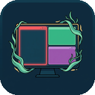

<p align="center">
  
</p>

# Kelp

[](https://github.com/UberMetroid/kelp/actions/workflows/ci.yml)
[](https://extensions.gnome.org/extension/11479/kelp/)
[](https://github.com/UberMetroid/kelp/releases/latest)
[](LICENSE)
[](https://ubermetroid.github.io/tuition-not-coffee)
[](https://github.com/UberMetroid/kelp)

**Kelp** (`kelp@ubermetroid.github.io`) provides **three layout modes** — **Octopus (2D Grid)**, **Seahorse (Scrolling Strip)**, and **Otter (Floating)** — each with its own top-bar indicator icon (`kelp-octopus-symbolic.svg`, `kelp-seahorse-symbolic.svg`, `kelp-otter-symbolic.svg`), plus window stacking, active focus borders, and a 4-tab Libadwaita Settings & About dialog for **GNOME 45–50 on Wayland**.

Built from System76's Pop Shell — stripped of legacy X11 and launcher bloat, and updated for modern GNOME (`45` through `50`, including Ubuntu 24.04+, Fedora, Arch, and Debian). Official project artwork is archived in [`brand/`](brand/) (`icon-512.png`, `icon-256.png`, `icon-160.png`, `favicon-64.png`).

> 🎓 **Support Kelp — [Tuition, Not Coffee — Help send my daughter to college](https://ubermetroid.github.io/tuition-not-coffee)** · 🧩 [**Get Kelp on GNOME Extensions**](https://extensions.gnome.org/extension/11479/kelp/) · ⭐ [**Star UberMetroid/kelp on GitHub**](https://github.com/UberMetroid/kelp)

---

## Three Layout Modes (One Left-Click Away)

Left-clicking the top-bar icon (or pressing `Super + Y`) cycles through all 3 modes and **immediately reformats every open window** on your workspace:

| Top-Bar Icon | Layout Mode | Layout Style | Left-Click / Scroll Action |
| :---: | :--- | :--- | :--- |
|  | **Octopus — 2D Grid** *(Default)* | Hyprland-style 2D Binary Space Partitioning (`OctopusTiler` + `Forest` in `engine/octopus/`) with tabbed stacks (`Super + S`). | Left-click switches to **Seahorse** |
|  | **Seahorse — Scrolling Strip** | Niri/PaperWM-style horizontal scrolling strip of full-height columns (`SeahorseTiler` in `engine/seahorse/`), progressively sizing from **1/1 full width** (1 window) → **1/2 each** (2 windows) → **1/3 each** (3+ windows, up to 3 columns visible at once; `Super + O` for 100% full-width toggle, `Super + Enter` -> `Shift + Left/Right` or mouse drag to resize column widths) with clickable `8px` screen-edge peek slivers that jump directly to off-screen neighbor columns. | Left-click switches to **Otter** · Mouse wheel scrolls columns |
|  | **Otter — Floating** | Standard GNOME / Windows free-floating mode (`engine/otter/otter_tiler.js`) with gently cascaded windows, monitor edge-tiling, and `Ctrl/Shift + Super + Left/Right/Up/Down` 50% edge-snap. | Left-click switches to **Octopus** |

---

## What You Get Out of the Box

- **3 Instant Layout Modes**: Switch seamlessly between **Octopus (2D Grid)**, **Seahorse (Scrolling Strip)**, and **Otter (Floating)** at any time.
- **Window Stacking (`Super + S`)**: Group tiled windows into tabbed stacks in Octopus mode, or toggle 100% full-width columns in Seahorse mode.
- **Hyprland-Style Active Border**: High-contrast `2px` active window border (`rgb(255,0,0)`), `6px` inner/outer gaps, 1-click color presets (*Gruvbox Amber*, *Kelp Emerald*, *Ocean Cyan*, *Coral Red*), and window titlebars hidden by default.
- **4-Tab Libadwaita Settings & About Window**: Right-click the top-bar icon and click **Settings & About…** (or run `gnome-extensions prefs kelp@ubermetroid.github.io`) for dedicated **Tiling & Modes**, **Appearance & Borders**, **Shortcuts**, and **About & Support** pages.
- **Top-Bar Quick Menu**: Right-click to pick a mode directly or toggle **Keyboard Shortcuts (On/Off)**, **Focus Follows Mouse (On/Off)**, **Smart Gaps**, **Show Active Hint**, **Retile Workspace**, and **Settings & About…**.
- **Built-In & Persistent Float Rules**: Dialogs, Picture-in-Picture, Desktop Icons NG (`ding@rastersoft.com`), Steam, `caligula`, `btm`, and `macchina` float automatically; add custom per-app or per-window exceptions in two clicks with automatic GSettings persistence (`float-rules`) across restarts.
- **Identical Everywhere**: Installing from [GNOME Extensions](https://extensions.gnome.org/extension/11479/kelp/) or GitHub Releases gives you the exact same out-of-the-box configuration.

---

## Quick Install

Choose either installation method below — both give you the exact same out-of-the-box configuration:

### Option 1 — Install from GNOME Extensions (`extensions.gnome.org`)

Install with one click in your browser or through **Extension Manager**:

👉 [**https://extensions.gnome.org/extension/11479/kelp/**](https://extensions.gnome.org/extension/11479/kelp/)

### Option 2 — Install from GitHub Release `.zip`

Download `kelp@ubermetroid.github.io.shell-extension.zip` from [**GitHub Releases (`v2.0.4`)**](https://github.com/UberMetroid/kelp/releases/latest):

```bash
gnome-extensions install --force kelp@ubermetroid.github.io.shell-extension.zip
gnome-extensions enable kelp@ubermetroid.github.io
```

*(On Wayland, log out and log back in once if this is your first time installing the extension.)*

---

## Keyboard Shortcuts

| Shortcut | Action |
| :--- | :--- |
| `Super + Y` | Cycle Kelp tiling mode (**Octopus -> Seahorse -> Otter**) |
| `Super + Arrow` or `Super + H / J / K` | Focus window Left / Down / Up / Right (or scroll columns in **Seahorse** mode; `Super + L` stays GNOME Lock Screen) |
| `Ctrl + Super + Arrow` or `Ctrl + Super + H / J / K / L` | Move tiled window / swap column / edge-snap floating window (**Otter** mode) |
| `Super + Shift + Arrow` or `Super + Shift + H / J / K / L` | Move tiled window / swap column / edge-snap floating window (**Otter** mode) |
| `Super + G` | Toggle floating mode for the focused window |
| `Super + Enter` | Enter interactive adjustment mode (`Arrows/HJKL` to move, `Shift + Arrows/HJKL` to resize, `Enter` to apply, `Esc` to cancel) |
| `Super + M` / `Super + Q` | Toggle maximize / Close focused window (`<Super>m`, `<Super>q`, `<Alt>F4`) |
| `Super + O` | Toggle split orientation (**Octopus**) or toggle 100% full-width vs progressive `1 -> 1/2 -> 1/3` column width (**Seahorse**) |
| `Super + S` | Toggle tabbed stacking (**Octopus**) or full-width column (**Seahorse**) |
| `Super + Alt + Arrow / H / J / K / L` | Switch to workspace Left / Down / Up / Right |
| `Super + Alt + Shift + Arrow / H / J / K / L` | Move window to another workspace |
| `Ctrl + Super + Shift + Arrow / H / J / K / L` | Move window to another monitor |

---

## Right-Click Quick Settings Menu & 4-Tab Libadwaita Preferences

Right-clicking the top-bar icon opens the quick settings menu:

| Control | Default | Description |
| :--- | :--- | :--- |
| **Octopus (2D Grid)** | **Active** | Hyprland-style 2D binary tree auto-tiling and stacking. |
| **Seahorse (Scrolling Strip)** | Mode | Niri-style horizontal scrolling strip of full-height vertical columns (`1 -> 1/2 -> 1/3`). |
| **Otter (Floating)** | Mode | Free-floating windows with edge-tiling and keyboard edge-snap. |
| **Keyboard Shortcuts** | **On** | Turn all Kelp keyboard shortcuts on or off (useful for full-screen games, VMs, or remote desktop apps). |
| **Focus Follows Mouse** | **Off** | Switch GNOME's window focus mode between Click-to-Focus (`click`) and Focus-Follows-Mouse (`sloppy`). |
| **Retile Workspace** | Action | Immediately recalculate and snap all open windows on the active workspace into alignment. |
| **Floating Window Exceptions** | Action | Open the picker to float specific windows or applications. |
| **Show Active Hint** | **On** | Show or hide the `2` px colored border around the focused window. |
| **Smart Gaps** | **Off** | Hide outer screen gaps when only a single tiled window is open on a workspace. |
| **Active Hint Border Radius** | **`2` px** | Adjust the corner radius of the active window border (`0–32 px`). |
| **Gaps** | **`6` px** | Adjust inner and outer window gaps (`0–64 px`). |
| **Settings & About…** | Action | Open the 4-tab Libadwaita Preferences window (**Tiling & Modes**, **Appearance & Borders**, **Shortcuts**, **About & Support**). |

---

## Why Trust Kelp? (Security & Privacy)

Because GNOME Shell extensions run inside your Wayland compositor process, Kelp is built to be small, transparent, and verifiable:

- **No background daemons or subprocesses**: Everything runs natively through GNOME Shell's window manager APIs.
- **No network access or telemetry**: Kelp never connects to the internet.
- **Zero third-party dependencies**: The extension uses zero `npm` packages and zero external runtime dependencies.
- **Clean disable & screen-lock behavior**: Disabling the extension or locking your screen cleanly removes all shortcuts, window borders, and signal listeners, and restores your previous Mutter `edge-tiling` and `focus-mode` settings.

---

## Supported GNOME Versions

| GNOME Version | Distros | Status |
| :--- | :--- | :--- |
| **GNOME 50** | Fedora 44+, Arch Linux, GNOME 50 | Supported |
| **GNOME 48 / 49** | Fedora 42 / 43, Ubuntu 25.04 / 25.10, Debian Testing | Supported |
| **GNOME 45 / 46 / 47** | Ubuntu 24.04 LTS, Debian 13, Fedora 39–41 | Supported |

---

## 🎓 Sponsor / Support — Tuition, Not Coffee

If Kelp saves you time every day, please consider supporting the project:

- 🎓 **Sponsor / Donate**: [**Tuition, Not Coffee — Help send my daughter to college**](https://ubermetroid.github.io/tuition-not-coffee)
- 🧩 **GNOME Extensions**: [**extensions.gnome.org/extension/11479/kelp/**](https://extensions.gnome.org/extension/11479/kelp/)
- ⭐ **Star on GitHub**: [**github.com/UberMetroid/kelp**](https://github.com/UberMetroid/kelp)

---

## License

Released under the [GNU General Public License v3.0 or later](LICENSE) (`GPL-3.0-or-later`).
Derived from [System76 Pop Shell](https://github.com/pop-os/shell).
